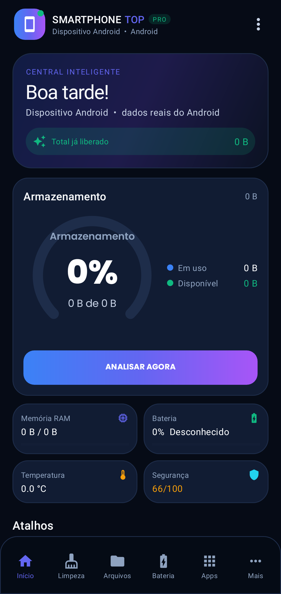
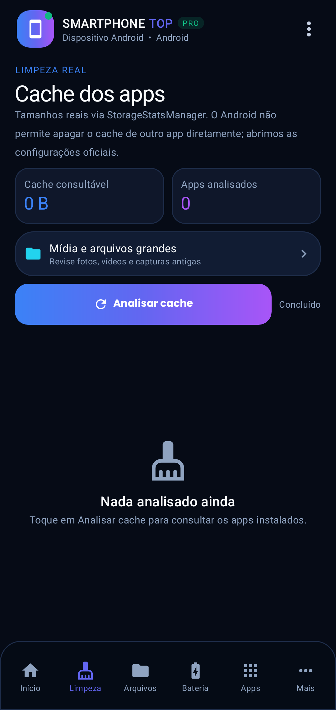
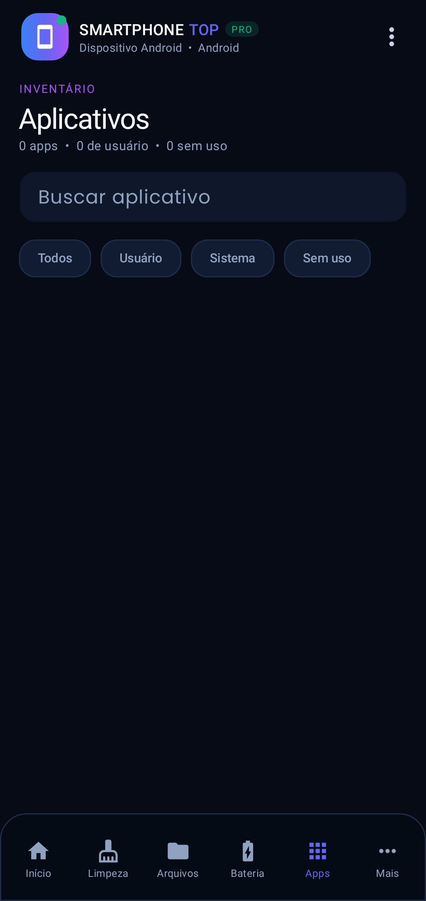
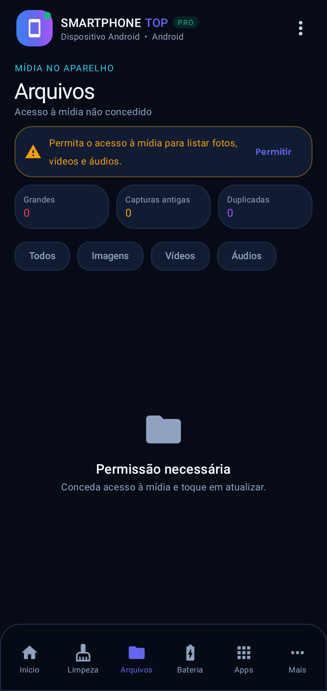
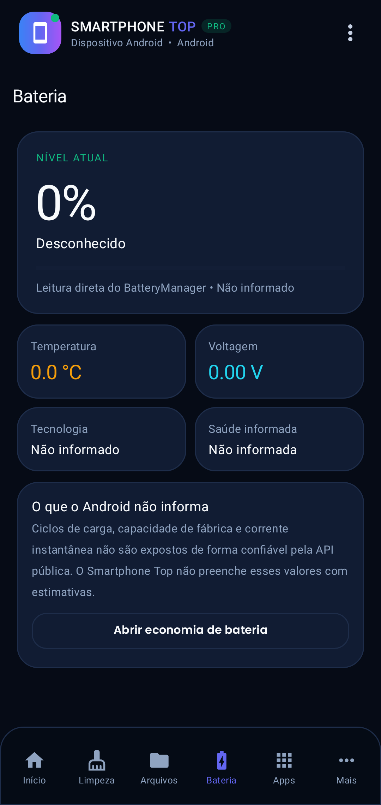
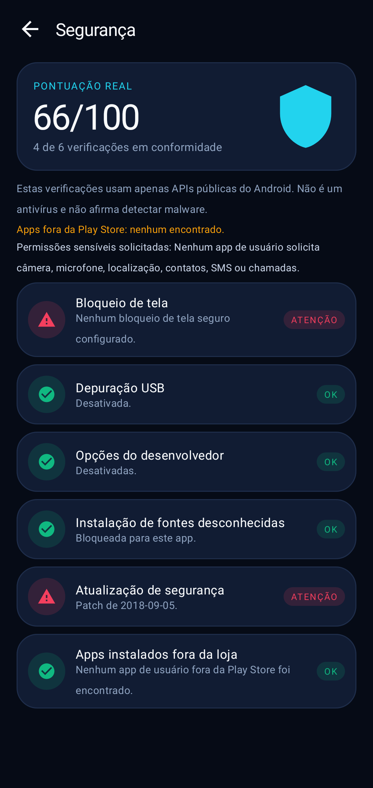
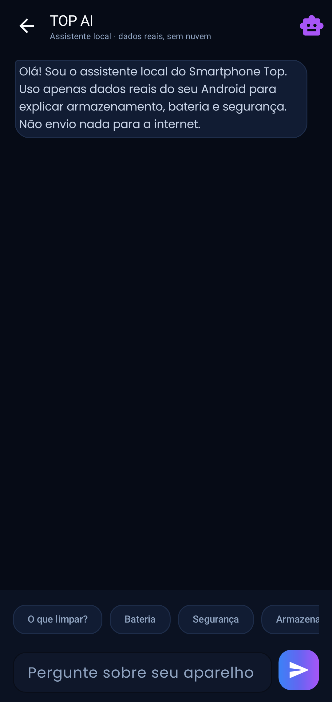

# Smartphone Top — Android nativo

[](https://github.com/aldecirv/smartphone-top-android/releases/latest)
[](https://github.com/aldecirv/smartphone-top-android/actions/workflows/build.yml)

**Limpeza, desempenho e privacidade. Com dados reais do Android.**

Aplicativo Android nativo em **Kotlin + XML + Material 3**, implementado a partir do conceito do **Smartphone Top** (web app + trechos de um limpador de cache em Compose presentes no archive). Esta versão usa **APIs públicas do Android** e **não inventa métricas**.



## O que é real

- **Armazenamento**: leitura de `StatFs` do armazenamento interno.
- **RAM**: `ActivityManager.MemoryInfo`.
- **Bateria**: nível, status, temperatura, voltagem, tecnologia e saúde informada pelo `BatteryManager`.
- **Cache por aplicativo**: `StorageStatsManager` + permissão especial **Acesso a Dados de Uso**.
- **Apps instalados**: `PackageManager`, com tamanhos de app/dados/cache quando o Android permite.
- **Arquivos**: mídia real do aparelho via `MediaStore` (fotos, vídeos e áudios), com exclusão confirmada pelo sistema.
- **Segurança**: verificações de bloqueio de tela, depuração USB, opções do desenvolvedor, fontes desconhecidas, patch de segurança e apps de usuário instalados fora da Play Store.
- **Histórico**: apenas liberações de espaço medidas de verdade; nunca registros simulados.

## O que o Android não permite — e o app não finge

- **Limpar o cache de outros apps diretamente**: desde o Android 8 isso é bloqueado para apps de terceiros. O Smartphone Top mede o cache real e abre as **configurações oficiais** do app; você toca em “Limpar cache” e o app mede o delta ao voltar.
- **Ciclos de bateria, capacidade de fábrica e corrente instantânea**: não são expostos de forma confiável pela API pública. O app mostra “não informado” em vez de estimar.
- **Antivírus/malware**: o módulo Segurança é uma auditoria de configuração, não um scanner de malware.
- **Arquivos arbitrários**: o acesso é a mídia compartilhada autorizada pelo usuário; não há “limpeza profunda” de dados de outros apps nem root.

## Telas

A navegação principal segue o preview: **Início, Limpeza, Arquivos, Bateria e Apps** + **Mais**, com Segurança, TOP AI, Histórico e Ajustes.

- **Início**: saudação, armazenamento com medidor, RAM, bateria, temperatura, segurança, atalhos, **análise real** de cache/mídia e acesso rápido a TOP AI/Bateria.
- **Limpeza**: cache real por app, permissão de uso, abertura das configurações oficiais, registro do espaço liberado e atalho para mídia/arquivos grandes.
- **Arquivos**: mídia real, cartões de **arquivos grandes**, **capturas antigas** e **duplicadas exatas por SHA-256**, filtros, miniaturas, seleção múltipla e exclusão confirmada pelo Android.
- **Bateria**: nível, status, temperatura, voltagem, tecnologia, saúde informada e atalho de economia.
- **Apps**: inventário real, busca, filtros usuário/sistema/**sem uso**, tamanhos, versão, instalador, permissões solicitadas, último uso e desinstalação pelo sistema.
- **Segurança**: verificações de configuração, apps fora da Play Store e resumo de permissões sensíveis solicitadas.
- **TOP AI**: assistente local com respostas baseadas nos dados reais do aparelho.
- **Histórico**: apenas liberações de espaço realmente medidas, com total e registros.
- **Ajustes**: permissões, limite de aviso de armazenamento e informações do app.

| Limpeza | Apps | Arquivos |
|---|---|---|
|  |  |  |

| Bateria | Segurança | TOP AI |
|---|---|---|
|  |  |  |

## Permissões

| Permissão | Uso |
|---|---|
| `PACKAGE_USAGE_STATS` (especial) | Ler o cache real por app via `StorageStatsManager`. Concedida manualmente em Configurações > Acesso a Dados de Uso. |
| `QUERY_ALL_PACKAGES` | Listar os aplicativos instalados no Android 11+. |
| `READ_MEDIA_IMAGES/VIDEO/AUDIO` (33+) ou `READ_EXTERNAL_STORAGE` (≤32) | Listar mídia compartilhada. |
| `WRITE_EXTERNAL_STORAGE` (≤29) | Excluir mídia em Androids antigos. |

**Sem internet, sem conta, sem anúncios, sem telemetria e sem cobrança.** O app não pede `MANAGE_EXTERNAL_STORAGE` nem usa acessibilidade para forçar limpeza.

## TOP AI

O **TOP AI** é um assistente **local e determinístico**: responde sobre armazenamento, RAM, bateria, cache e segurança usando os dados reais do aparelho. Não envia nada para a nuvem e não se apresenta como modelo generativo.

## Arquitetura

```
app/src/main/java/com/smartphonetop/app/
├── core/        DeviceStats, CacheAnalyzer, MediaScanner, SecurityAuditor
├── data/        modelos, SmartStore (histórico/configurações)
├── ui/          MainActivity, Battery, Security, TopAi, History, Settings
│   ├── fragments/ Home, Clean, Files, Battery, Apps
│   ├── adapters/ apps, cache, mídia, histórico, segurança
│   ├── MoreSheet, DeepScanDialog, atividades secundárias
│   └── widgets/  StorageGaugeView
└── util/        Permissions, ThemeUtils
```

- Kotlin, `minSdk 26` (StorageStatsManager), `targetSdk 35`.
- ViewBinding, Material 3, RecyclerView, coroutines.
- Sem Room/Hilt para manter o APK enxuto; persistência local em SharedPreferences.
- Fonte Poppins (SIL OFL).

## Build

```bash
export JAVA_HOME=/caminho/para/jdk-17
gradle :app:assembleDebug
```

Release assinado:

```bash
export AURORA_KEYSTORE_PATH=/caminho/aurora.jks
export AURORA_KEYSTORE_PASS=...
export AURORA_KEY_ALIAS=aurora
export AURORA_KEY_PASS=...
gradle :app:assembleRelease
```

CI: `.github/workflows/build.yml` usa os secrets `AURORA_*`.

Testes:

```bash
gradle :app:testDebugUnitTest
```

Cobrem formatação de tamanhos, histórico/limites, navegação/Bateria/folha Mais e screenshots Robolectric de Início, Limpeza, Arquivos, Bateria, Apps, Segurança, Ajustes, Histórico e TOP AI.

## Limitações

- O resultado da limpeza assistida depende do fabricante e do momento em que o Android atualiza o `StorageStatsManager`.
- A lista de apps pode incluir apps de sistema; use os filtros.
- Sem a permissão de uso, os tamanhos e o “sem uso” aparecem como indisponíveis — não são estimados.
- A exclusão de mídia depende das permissões e do provedor do arquivo; duplicadas são detectadas por hash SHA-256 de mídia (até 80 arquivos candidatos, 80 MB cada).
- Categorias do preview que dependem de dados simulados ou de acesso irrestrito — arquivos residuais, APKs obsoletos, fotos borradas/semelhantes, compressão de mídia e perfis de aparelho — **não foram falsificadas**. O app faz apenas o que o Android permite: cache assistido, mídia e auditoria.
- O app não faz root, não usa acessibilidade para limpar outros apps e não é um antivírus.
- Tema claro/automático, lembretes e integração Gemini do preview não foram portados; o tema é escuro e o assistente é local/offline.
- Screenshots foram geradas em Robolectric; em aparelho real os números refletem o dispositivo.

## Versão

**1.1.0** — paridade ampliada com o preview: navegação de 5 centrais + Mais, Bateria como aba principal, análise real no Início, categorias de mídia (grandes/capturas/duplicadas), seleção múltipla, apps sem uso e detalhes de permissões. Tudo com APIs reais, sem inventar resultados.

APK: [**smartphone-top-1.1.0.apk**](https://github.com/aldecirv/smartphone-top-android/releases/download/v1.1.0/smartphone-top-1.1.0.apk) · [Release v1.1.0](https://github.com/aldecirv/smartphone-top-android/releases/tag/v1.1.0)
